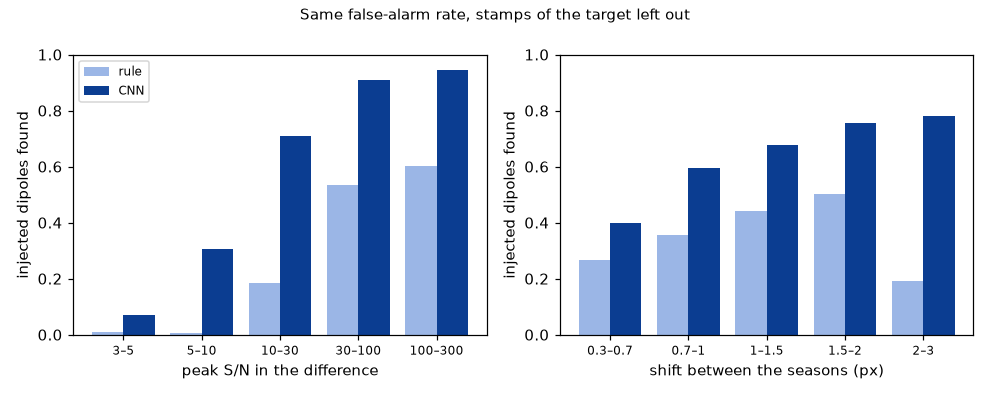
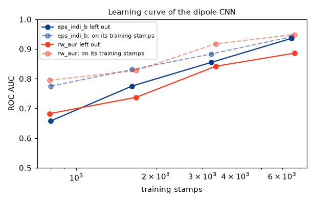

# The dipole CNN against the classic rule (task A9, stage 2)

Generated by `python -m training.evaluate`. Every score is **out of fold**: trained on
four targets, the CNN judges the fifth (`training/train.py`). Stamps of 3 × 32 × 32 (sum
A, sum B and their difference, `serafim/ai/stamps.py`).

## Decision

| Acceptance criterion | Needed | Got | |
| --- | --- | --- | --- |
| Out-of-fold ROC AUC on injected stamps | >= 0.9 | 0.910 | ✅ |
| Finds more injected dipoles than the rule at the same false alarms | sensitivity above the rule's | 62% vs 26% | ✅ |
| Calibration on injected stamps (ECE) | <= 0.05 | 0.022 | ✅ |
| Real: ROC AUC, movers against still saturated stars | >= 0.8 | 0.52 | ❌ |
| Real: still saturated stars called a dipole | <= 10% | 9/38 = 24% (95 % CI 13%-39%) | ❌ |
| Real: balanced accuracy not below the stage-1 rule's | at least the rule's | 0.60 vs 0.73 | ❌ |

**Experimental.** The pipeline keeps the stage-1 rule and its catalog check for every status. The CNN's p_dipole is shown only next to dipoles without saturated pixels (its domain: there it ranks the real Epsilon Indi B above real fixed stars and finds it more often than the rule), as an extra opinion that never changes a status. On saturated stars it does not tell one that moves from one that does not, and the real test has only three moving objects.

## Confusion matrix and its metrics

Injected: 8346 stamps out of fold (injected dipoles and hard negatives; the fixed stars and the sky are real). CNN at p_dipole ≥ 0.731, the threshold with the rule's false-alarm rate (2.0%); the threshold that maximizes informedness would be 0.379, with 86.3% specificity: too many false alarms for something as rare as a moving source. Real: 49 differences where a target moved ≥ 0.3 px (Barnard's Star, Epsilon Indi B, WISE 0855) and 38 of saturated stars that do not move (RW Aurigae, R Draconis). The stage-1 rule is the one the pipeline uses (whole image, halo lobes, catalog check).

| Metric | Injected: CNN | Injected: rule | Real: CNN | Real: stage-1 rule |
| --- | --- | --- | --- | --- |
| TP / FN / FP / TN | 2302 / 1418 / 94 / 4532 | 977 / 2743 / 94 / 4532 | 21 / 28 / 9 / 29 | 23 / 26 / 0 / 38 |
| Prevalence (share of dipoles in the test) | 0.446 | 0.446 | 0.563 | 0.563 |
| Sensitivity (recall, TPR) | 0.619 | 0.263 | 0.429 | 0.469 |
| Specificity (TNR) | 0.980 | 0.980 | 0.763 | 1.000 |
| Balanced accuracy | 0.799 | 0.621 | 0.596 | 0.735 |
| Informedness (Youden's J) | 0.598 | 0.242 | 0.192 | 0.469 |
| ROC AUC | 0.910 | — | 0.521 | — |
| Precision (PPV) | 0.961 | 0.912 | 0.700 | 1.000 |
| NPV | 0.762 | 0.623 | 0.509 | 0.594 |
| Accuracy | 0.819 | 0.660 | 0.575 | 0.701 |
| MCC | 0.658 | 0.360 | 0.200 | 0.528 |
| Markedness | 0.722 | 0.535 | 0.209 | 0.594 |
| F1 | 0.753 | 0.408 | 0.532 | 0.639 |
| Jaccard | 0.604 | 0.256 | 0.362 | 0.469 |
| Fowlkes-Mallows | 0.771 | 0.489 | 0.548 | 0.685 |
| Average precision (PR AUC) | 0.915 | — | 0.673 | — |
| Prevalence threshold | 0.153 | 0.218 | 0.426 | 0.000 |
| Precision if 10.0% of the places hold a dipole | 0.772 | 0.590 | 0.167 | 1.000 |
| Precision if 1.0% of the places hold a dipole | 0.235 | 0.115 | 0.018 | 1.000 |
| Precision if 0.1% of the places hold a dipole | 0.030 | 0.013 | 0.002 | 1.000 |

Precision depends on how common dipoles are; the test sets have about half. In a real
difference a mover is one place in thousands, so neither the CNN nor the rule can scan
blindly: they judge places that already hold a 5-sigma pair of blobs, and the catalog
check removes the stars that do not move.

The stage-1 rule's 1.000 come from 0 false alarms in 38 stamps of only two still stars: its real false-alarm rate could still be up to 9% (95 % Wilson).

## Its domain: sources that are not saturated

Real movers against the 2762 real fixed-star and sky stamps of the fields left out (the CNN calls 1.0% of those a dipole):

| Mover | Differences | ROC AUC against fixed stars and sky | CNN finds | Stage-1 rule finds |
| --- | --- | --- | --- | --- |
| barnard | 18 | 0.982 | 9 | 15 |
| eps_indi_b | 15 | 0.874 | 12 | 8 |
| wise_0855 | 16 | 0.384 | 0 | 0 |

Epsilon Indi B (not saturated) is the case the CNN is for. Barnard's Star is saturated:
the rule's halo logic finds it more often. WISE 0855 (S/N 5–7 in one season) stays below
what either can see.

## Injected dipoles: by S/N, by shift, saturated

At the same false-alarm rate: sensitivity 26% (rule) against 62% (CNN); at peak S/N under 10, 1% against 20%; saturated movers (core masked) 1% against 37%.

| Peak S/N (not saturated) | Stamps | Rule | CNN |
| --- | --- | --- | --- |
| 3–5 | 347 | 1% | 7% |
| 5–10 | 451 | 0% | 31% |
| 10–30 | 698 | 18% | 71% |
| 30–100 | 809 | 53% | 91% |
| 100–300 | 671 | 60% | 94% |

| Shift (px) | Stamps | Rule | CNN |
| --- | --- | --- | --- |
| 0.3–0.7 | 437 | 27% | 40% |
| 0.7–1 | 316 | 36% | 59% |
| 1–1.5 | 565 | 44% | 68% |
| 1.5–2 | 559 | 50% | 75% |
| 2–3 | 1099 | 19% | 78% |

## False alarms, by kind of negative

| Negative | Stamps | Rule | CNN |
| --- | --- | --- | --- |
| background | 1395 | 0.4% | 0.9% |
| brightness | 465 | 1.5% | 2.8% |
| pixel_pair | 465 | 8.6% | 0.9% |
| saturated_core | 190 | 0.5% | 22.1% |
| saturated_still | 744 | 0.5% | 0.9% |
| star | 1367 | 2.6% | 1.2% |

## Enough data? The learning curve

Trained on 1/8, 1/4, 1/2 and all of the differences of four targets (`python -m training.learning_curve`):

| Target left out | Training stamps | AUC on its training stamps | AUC on the target left out |
| --- | --- | --- | --- |
| eps_indi_b | 801 | 0.775 | 0.658 |
| eps_indi_b | 1625 | 0.831 | 0.775 |
| eps_indi_b | 3238 | 0.883 | 0.855 |
| eps_indi_b | 6498 | 0.941 | 0.935 |
| rw_aur | 792 | 0.795 | 0.682 |
| rw_aur | 1682 | 0.828 | 0.737 |
| rw_aur | 3363 | 0.917 | 0.842 |
| rw_aur | 6672 | 0.949 | 0.886 |

From half to all of the data the held-out AUC still rises by +0.081, +0.044: the curve has not flattened, so more data would still help. The gap between the stamps it trained on and the ones it never saw is at most 0.063 at full size: no sign of memorizing (overfitting).

## Stability: each target left out

| Target left out | ROC AUC | Dipoles found | False alarms |
| --- | --- | --- | --- |
| barnard | 0.906 | 58% | 0.9% |
| eps_indi_b | 0.935 | 70% | 1.5% |
| r_dra | 0.903 | 58% | 2.1% |
| rw_aur | 0.886 | 63% | 4.8% |
| wise_0855 | 0.916 | 58% | 0.4% |
| mean ± sd | 0.909 ± 0.018 | | |

## Calibration: does p_dipole = 0.8 mean 8 in 10?

On the injected stamps, expected calibration error 0.022. (Not measured on the real
stamps: too few.)

| p_dipole | Mean p | Share that are dipoles | Stamps |
| --- | --- | --- | --- |
| 0.0–0.1 | 0.08 | 0.05 | 833 |
| 0.1–0.2 | 0.15 | 0.11 | 2245 |
| 0.2–0.3 | 0.24 | 0.24 | 1097 |
| 0.3–0.4 | 0.34 | 0.37 | 650 |
| 0.4–0.5 | 0.44 | 0.47 | 414 |
| 0.5–0.6 | 0.55 | 0.56 | 303 |
| 0.6–0.7 | 0.65 | 0.65 | 319 |
| 0.7–0.8 | 0.75 | 0.77 | 280 |
| 0.8–0.9 | 0.85 | 0.87 | 334 |
| 0.9–1.0 | 0.98 | 0.99 | 1871 |

## Each real target

| Target | Differences used | CNN says dipole | Stage-1 rule keeps a dipole | Median p_dipole |
| --- | --- | --- | --- | --- |
| barnard | 18 | 9 | 15 | 0.74 |
| eps_indi_b | 15 | 12 | 8 | 0.96 |
| r_dra | 20 | 4 | 0 | 0.65 |
| rw_aur | 18 | 5 | 0 | 0.39 |
| wise_0855 | 16 | 0 | 0 | 0.14 |

Few independent objects (3 movers, 2 still stars), so the intervals are wide: the CNN finds 21/49 real movers (95 % CI 30%-57%), the stage-1 rule 23 (34%-61%).
