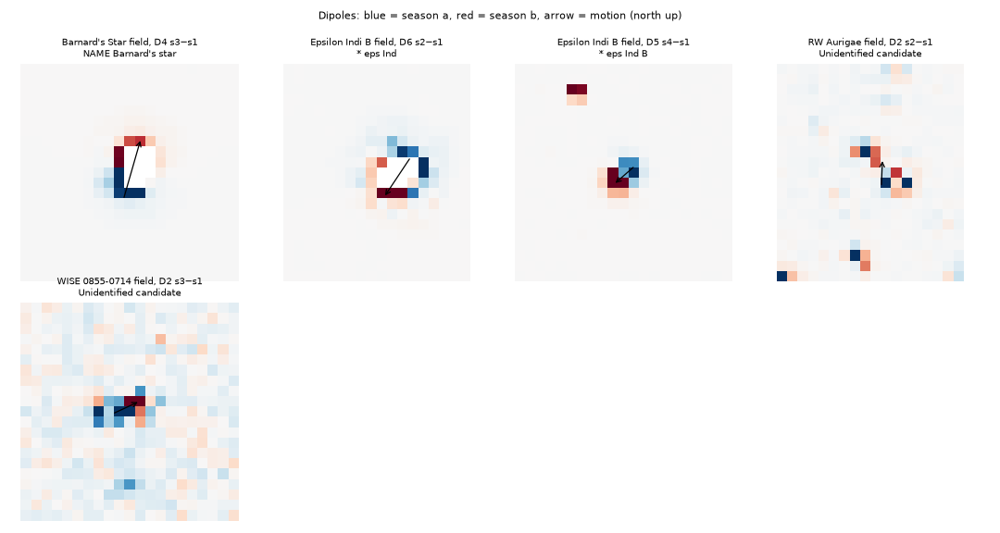

# Motion dipoles in the season differences (task A9, stage 1: the rule)

Generated by `python -m serafim.validation.dipoles` from the silver differences and
the catalog layers of gold. A dipole is a negative blob (where something was in season a)
next to a positive one (where it went in season b): blobs at 5 sigma of the measured noise, at most 3 px apart (farther around a
saturated core, whose two halo lobes are what shows) with similar fluxes. Known: it
matches a catalog source that moves. Discarded: edge, masked pixels, the residual of a
star that does not move or the glare of a saturated one. Unidentified candidate: anything
else, for a person to check. Lobes apart is not the shift: for a shift smaller than the
PSF the lobes stay ~2 px apart.

## Checks

- ✅ Barnard's Star: found as Known in 6 of 6 last-minus-first differences (detectors 1, 2, 3, 4, 5, 6)
- ✅ Epsilon Indi B: found as Known in 4 of 6 last-minus-first differences (detectors 2, 3, 5, 6)
- ⚠️ WISE 0855-0714: found as Known in 0 of 6 last-minus-first differences: too faint for the rule (S/N 5-7 in one season); the target of the CNN
- ✅ RW Aurigae (only changes brightness): 0 Known or unidentified dipoles at the target
- ✅ R Draconis (only changes brightness): 0 Known or unidentified dipoles at the target

## Per target

| Target | Differences | Dipoles | Known | Discarded | Unidentified candidates |
| --- | --- | --- | --- | --- | --- |
| Barnard's Star | 18 | 137 | 15 | 122 | 0 |
| Epsilon Indi B | 21 | 23 | 13 | 10 | 0 |
| R Draconis | 20 | 17 | 0 | 17 | 0 |
| RW Aurigae | 18 | 125 | 0 | 124 | 1 |
| WISE 0855-0714 | 16 | 17 | 0 | 16 | 1 |

## Known

| Target | Detector | Seasons | From (x, y) | Lobes apart (px) | S/N | Reason |
| --- | --- | --- | --- | --- | --- | --- |
| Barnard's Star | 1 | 3 − 1 | (72.3, 69.7) | 5.06 (halo) | 3286 | NAME Barnard's star (simbad) |
| Barnard's Star | 1 | 3 − 2 | (71.6, 69.9) | 4.72 (halo) | 833 | NAME Barnard's star (simbad) |
| Barnard's Star | 2 | 2 − 1 | (73.7, 68.1) | 4.15 (halo) | 1493 | NAME Barnard's star (simbad) |
| Barnard's Star | 2 | 3 − 1 | (72.7, 68.3) | 6.58 (halo) | 2660 | NAME Barnard's star (simbad) |
| Barnard's Star | 3 | 2 − 1 | (72.9, 68.4) | 5.23 (halo) | 3637 | NAME Barnard's star (simbad) |
| Barnard's Star | 3 | 3 − 1 | (72.5, 68.4) | 5.82 (halo) | 6613 | NAME Barnard's star (simbad) |
| Barnard's Star | 3 | 3 − 2 | (71.3, 70.2) | 4.95 (halo) | 2751 | NAME Barnard's star (simbad) |
| Barnard's Star | 4 | 2 − 1 | (71.7, 68.5) | 5.08 (halo) | 13599 | NAME Barnard's star (simbad) |
| Barnard's Star | 4 | 3 − 1 | (71.4, 68.4) | 6.13 (halo) | 14276 | NAME Barnard's star (simbad) |
| Barnard's Star | 4 | 3 − 2 | (70.6, 69.8) | 5.12 (halo) | 11267 | NAME Barnard's star (simbad) |
| Barnard's Star | 5 | 2 − 1 | (72.3, 69.0) | 4.16 (halo) | 9700 | NAME Barnard's star (simbad) |
| Barnard's Star | 5 | 3 − 1 | (71.9, 69.1) | 4.70 (halo) | 10225 | NAME Barnard's star (simbad) |
| Barnard's Star | 5 | 3 − 2 | (71.6, 69.8) | 4.42 (halo) | 5348 | NAME Barnard's star (simbad) |
| Barnard's Star | 6 | 2 − 1 | (73.7, 69.0) | 4.54 (halo) | 2451 | NAME Barnard's star (simbad) |
| Barnard's Star | 6 | 3 − 1 | (72.4, 69.8) | 3.64 (halo) | 5838 | NAME Barnard's star (simbad) |
| Epsilon Indi B | 2 | 4 − 1 | (74.0, 73.5) | 2.48 | 294 | * eps Ind B (simbad) |
| Epsilon Indi B | 2 | 3 − 2 | (74.0, 73.0) | 2.47 | 64 | * eps Ind B (simbad) |
| Epsilon Indi B | 3 | 2 − 1 | (73.9, 73.9) | 2.35 | 152 | * eps Ind B (simbad) |
| Epsilon Indi B | 3 | 4 − 1 | (73.9, 73.5) | 2.47 | 267 | * eps Ind B (simbad) |
| Epsilon Indi B | 3 | 3 − 2 | (74.1, 73.2) | 2.44 | 194 | * eps Ind B (simbad) |
| Epsilon Indi B | 3 | 4 − 3 | (73.4, 73.5) | 2.35 | 69 | * eps Ind B (simbad) |
| Epsilon Indi B | 5 | 4 − 1 | (74.1, 73.6) | 2.73 | 569 | * eps Ind B (simbad) |
| Epsilon Indi B | 5 | 4 − 2 | (74.0, 73.2) | 2.63 | 530 | * eps Ind B (simbad) |
| Epsilon Indi B | 6 | 2 − 1 | (74.0, 74.0) | 2.72 | 52 | * eps Ind B (simbad) |
| Epsilon Indi B | 6 | 2 − 1 | (139.8, 72.5) | 4.68 (halo) | 6064 | * eps Ind (simbad) |
| Epsilon Indi B | 6 | 4 − 1 | (73.9, 73.6) | 2.62 | 175 | * eps Ind B (simbad) |
| Epsilon Indi B | 6 | 3 − 2 | (74.2, 73.0) | 2.50 | 86 | * eps Ind B (simbad) |
| Epsilon Indi B | 6 | 4 − 3 | (73.1, 73.8) | 2.77 | 42 | * eps Ind B (simbad) |

## Unidentified candidates

| Target | Detector | Seasons | From (x, y) | Lobes apart (px) | S/N | Reason |
| --- | --- | --- | --- | --- | --- | --- |
| RW Aurigae | 2 | 2 − 1 | (137.6, 90.6) | 2.72 | 30 | No moving source of Gaia, CatWISE or SIMBAD there |
| WISE 0855-0714 | 2 | 3 − 1 | (51.3, 43.8) | 2.93 | 15 | No moving source of Gaia, CatWISE or SIMBAD there |

## Discarded, by reason

- residual of a star that does not move: 221
- at the edge: 67
- around the saturated core of Gaia DR3 6412595290592307840 (gaia): 1

