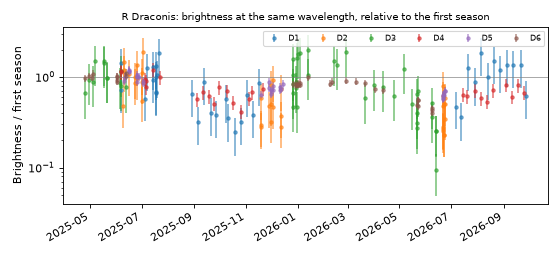
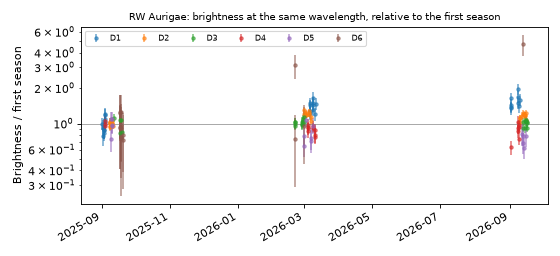
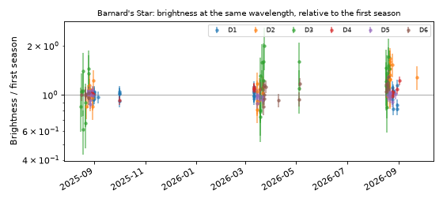

# Light curves of the saturated targets (task A4)

Generated by `python -m serafim.validation.light_curves` from the bronze cutouts.
The saturated core cannot be measured, so each frame measures the light in a ring
around it (3 px wide, starting 1 px beyond the farthest
saturated or BLOOM pixel of that detector). Per detector, ln(ring) = P(wavelength) +
offset(season): the ratio is the brightness of a season relative to the first one, at
the same wavelength. Barnard's Star does not vary and is the control: its ratios
should be close to 1.

## R Draconis (`r_dra`)

207 frames used.

**Period search** (sine fit, 80–600 days): best 244 days (half power 199–314), power 0.63, false alarm 0.005, 18 months with data: a periodic change.

| Season | Brightness / season 1 (all detectors) | Detectors | Range |
| --- | --- | --- | --- |
| 1 | 1.00 ± 0.00 | 6 | — |
| 2 | 0.74 ± 0.09 | 6 | 0.46–0.97 |
| 3 | 0.85 ± 0.05 | 2 | 0.84–1.01 |
| 4 | 0.55 ± 0.08 | 6 | 0.33–0.99 |

| Detector | Season | Ratio | Frames | Ring (px) |
| --- | --- | --- | --- | --- |
| 1 | 2 | 0.46 ± 0.08 | 12 | 10–13 |
| 1 | 4 | 0.99 ± 0.18 | 12 | 10–13 |
| 2 | 2 | 0.46 ± 0.08 | 12 | 9–12 |
| 2 | 4 | 0.39 ± 0.07 | 12 | 9–12 |
| 3 | 2 | 0.97 ± 0.21 | 11 | 11–14 |
| 3 | 3 | 1.01 ± 0.21 | 11 | 11–14 |
| 3 | 4 | 0.33 ± 0.07 | 10 | 11–14 |
| 4 | 2 | 0.60 ± 0.05 | 11 | 11–14 |
| 4 | 4 | 0.66 ± 0.06 | 10 | 11–14 |
| 5 | 2 | 0.74 ± 0.03 | 11 | 11–14 |
| 5 | 4 | 0.63 ± 0.03 | 7 | 11–14 |
| 6 | 2 | 0.83 ± 0.04 | 8 | 11–14 |
| 6 | 3 | 0.84 ± 0.04 | 8 | 11–14 |
| 6 | 4 | 0.48 ± 0.02 | 7 | 11–14 |

## RW Aurigae (`rw_aur`)

136 frames used.

**Period search** (sine fit, 80–600 days): best 152 days (half power 125–171), power 0.17, false alarm 0.005, 4 months with data: no period can be claimed (false alarm too high, or too few months).

| Season | Brightness / season 1 (all detectors) | Detectors | Range |
| --- | --- | --- | --- |
| 1 | 1.00 ± 0.00 | 6 | — |
| 2 | 1.15 ± 0.09 | 5 | 0.86–1.39 |
| 3 | 1.13 ± 0.13 | 5 | 0.74–1.54 |

| Detector | Season | Ratio | Frames | Ring (px) |
| --- | --- | --- | --- | --- |
| 1 | 2 | 1.39 ± 0.08 | 10 | 2–5 |
| 1 | 3 | 1.54 ± 0.09 | 9 | 2–5 |
| 2 | 2 | 1.21 ± 0.03 | 10 | 4–7 |
| 2 | 3 | 1.15 ± 0.03 | 10 | 4–7 |
| 3 | 2 | 1.03 ± 0.05 | 10 | 4–7 |
| 3 | 3 | 1.00 ± 0.06 | 9 | 4–7 |
| 4 | 2 | 0.90 ± 0.07 | 9 | 11–14 |
| 4 | 3 | 0.87 ± 0.07 | 7 | 11–14 |
| 5 | 2 | 0.86 ± 0.09 | 6 | 11–14 |
| 5 | 3 | 0.74 ± 0.10 | 5 | 11–14 |
| 6 | 2 | 2.25 ± 0.71 | 3 | 11–14 |
| 6 | 3 | 4.71 ± 1.44 | 1 | 11–14 |

## Barnard's Star (`barnard`)

154 frames used.

**Period search** (sine fit, 80–600 days): best 84 days (half power 80–89), power 0.05, false alarm 0.249, 8 months with data: no period can be claimed (false alarm too high, or too few months).

| Season | Brightness / season 1 (all detectors) | Detectors | Range |
| --- | --- | --- | --- |
| 1 | 1.00 ± 0.00 | 6 | — |
| 2 | 1.02 ± 0.03 | 6 | 0.96–1.20 |
| 3 | 1.04 ± 0.05 | 6 | 0.98–1.30 |

| Detector | Season | Ratio | Frames | Ring (px) |
| --- | --- | --- | --- | --- |
| 1 | 2 | 1.03 ± 0.04 | 10 | 11–14 |
| 1 | 3 | 0.98 ± 0.03 | 10 | 11–14 |
| 2 | 2 | 1.00 ± 0.09 | 9 | 10–13 |
| 2 | 3 | 1.30 ± 0.10 | 12 | 10–13 |
| 3 | 2 | 1.20 ± 0.17 | 12 | 7–10 |
| 3 | 3 | 1.28 ± 0.18 | 9 | 7–10 |
| 4 | 2 | 1.09 ± 0.05 | 5 | 11–14 |
| 4 | 3 | 1.06 ± 0.05 | 6 | 11–14 |
| 5 | 2 | 0.96 ± 0.03 | 7 | 11–14 |
| 5 | 3 | 0.99 ± 0.03 | 9 | 11–14 |
| 6 | 2 | 1.04 ± 0.05 | 10 | 11–14 |
| 6 | 3 | 1.15 ± 0.06 | 7 | 11–14 |

