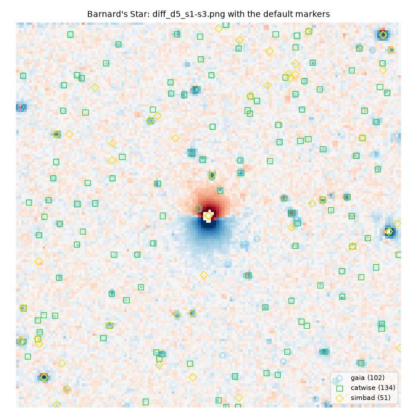
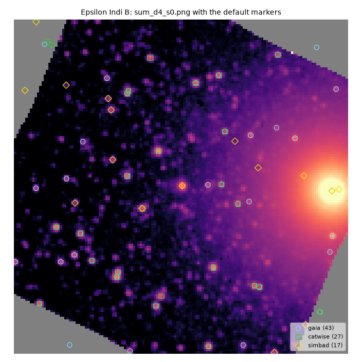
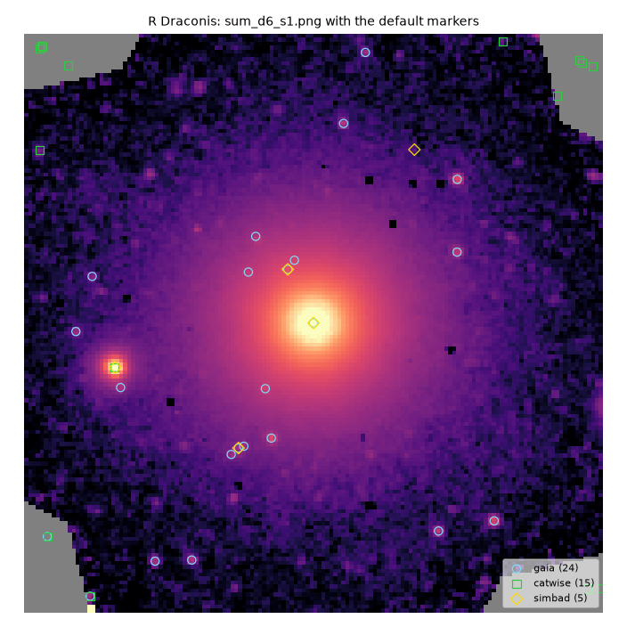
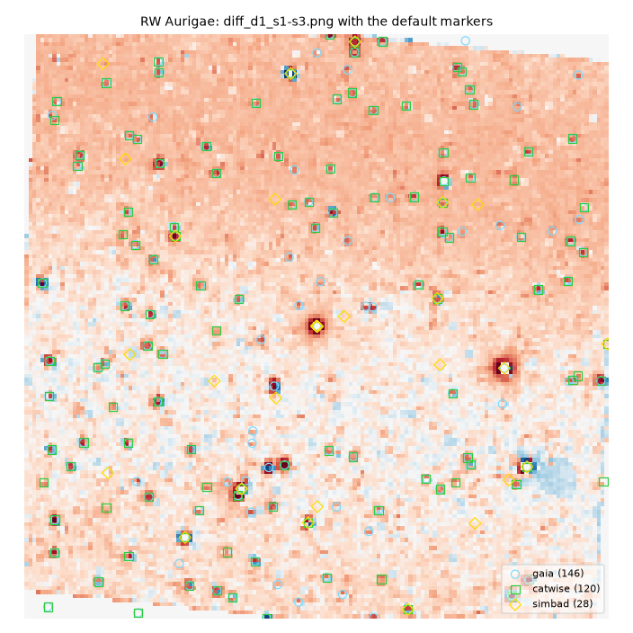
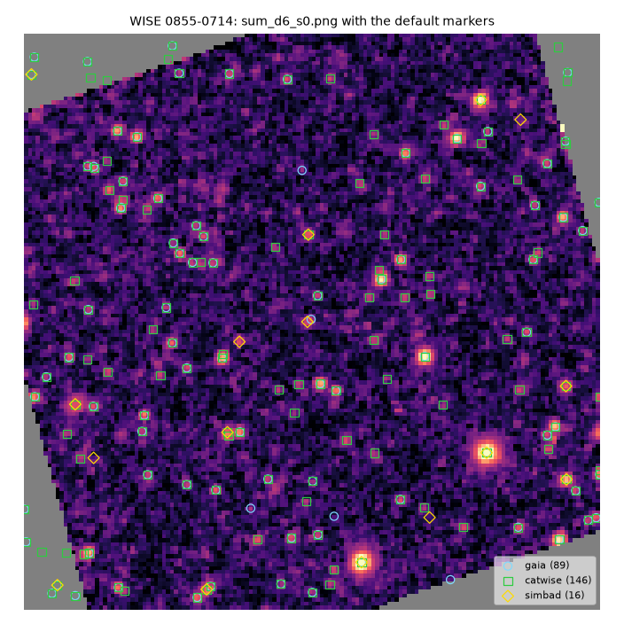

# Catalog markers on the real images (task A8)

Generated by `python -m serafim.validation.markers` from the real gold and its silver
sums. Each marker of `catalogs.parquet` is put on the grid with `wcs_json` (as the viewer
does) and a 1.5 px forced aperture on the sum says whether a source is there
(S/N ≥ 3). **Visible limit**: the magnitude down to which 80% of the markers have
a source under them beyond chance (the same measure at 400 random places of
each sum), the default cut of each layer in the viewer. **Out of place**: a
marker 1 mag brighter than that limit with nothing under it, or an isolated star more than 1 px
from its marker. Markers near the target, a saturated center or the edge are not judged.

| Target | Gaia G limit (D1–D6) | CatWISE W2 limit (D1–D6) | Judged | Out of place |
| --- | --- | --- | --- | --- |
| Barnard's Star | 17.5 / 17 / 17 / 17 / 16.5 / 16 | 15 / 15 / 15 / 15 / 14.5 / 14.5 | 19432 | 0 |
| Epsilon Indi B | 16 / 17.5 / 17 / 17 / 17 / 16 | 13.5 / 14.5 / 15 / 15 / 15 / 14.5 | 3140 | 0 |
| R Draconis | 18 / 18 / 17 / 16.5 / 16.5 / 15.5 | — / — / — / — / — / — | 1430 | 0 |
| RW Aurigae | 18 / 18 / 18 / 17.5 / 17 / 16.5 | 15 / 15 / 15 / 15 / 15 / 14.5 | 14064 | 0 |
| WISE 0855-0714 | 18 / 18 / 18 / 18 / 17 / 16.5 | 15 / 15 / 15 / 15 / 15 / 15 | 4620 | 0 |

## Barnard's Star (`barnard`)

Sum pixels far below the sky (10 sigma or more, left out; a silver problem): D4 s1 (1), D5 s3 (1), D6 s0 (6), D6 s1 (7), D6 s2 (3), D6 s3 (1).

Asteroids (SkyBoT, not judged): 24 markers, 11 with light under them.

No marker out of place.

## Epsilon Indi B (`eps_indi_b`)

Sum pixels far below the sky (10 sigma or more, left out; a silver problem): D4 s0 (3), D4 s1 (13), D4 s2 (2), D5 s0 (13), D5 s1 (18), D5 s4 (2), D6 s0 (28), D6 s1 (35), D6 s2 (1).

No marker out of place.

## R Draconis (`r_dra`)

Sum pixels far below the sky (10 sigma or more, left out; a silver problem): D4 s0 (3), D4 s1 (1), D4 s2 (4), D6 s0 (26), D6 s1 (33), D6 s4 (1).

No marker out of place.

## RW Aurigae (`rw_aur`)

Sum pixels far below the sky (10 sigma or more, left out; a silver problem): D6 s0 (4), D6 s1 (3), D6 s2 (3), D6 s3 (7).

Asteroids (SkyBoT, not judged): 294 markers, 22 with light under them.

No marker out of place.

## WISE 0855-0714 (`wise_0855`)

Sum pixels far below the sky (10 sigma or more, left out; a silver problem): D4 s0 (2), D4 s1 (11), D4 s2 (1), D4 s3 (4), D5 s0 (20), D5 s1 (22), D5 s3 (5), D6 s0 (3), D6 s3 (8).

Asteroids (SkyBoT, not judged): 42 markers, 9 with light under them.

No marker out of place.

