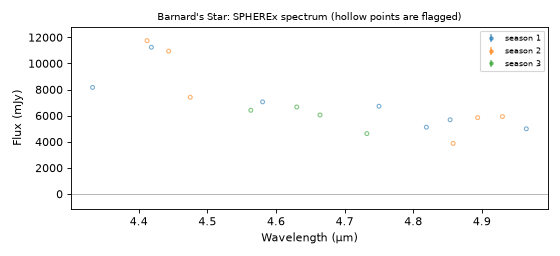
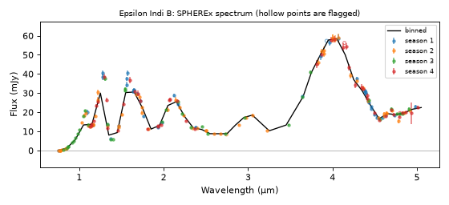
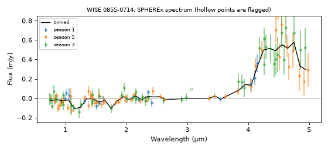

# SPHEREx spectra of the targets (task A4)

Generated by `python -m serafim.validation.spectra` from the bronze cutouts.
Each point is one frame: the target's flux at the wavelength SPHEREx saw it, by a PSF
fit (archive EPSF) together with any Gaia star within 20″ of the target. Saturated
targets are fitted on their wings (flag `saturated`); `blend` marks a neighbour closer
than 2 px, fitted too. Points near an edge or on flagged pixels are hollow and left
out of the binned line and of the catalog check.

**Saturated targets** (Barnard's Star, RW Aurigae, R Draconis): only the PSF wings can
be fitted, and the archive EPSF reaches just ~3.3 px from the center, mostly inside the
saturated core and its spill-over. Most of those fits do not describe the pixels
(reduced chi2 of 100 or more) and are flagged `poor_fit`: their absolute flux is not
reliable, and their brightness change is shown by the images (the size of the glow).
A frame where less than 5 % of the target's light falls in usable pixels gives no point.

## Barnard's Star (`barnard`)

17 points, 17 flagged.

## Epsilon Indi B (`eps_indi_b`)

193 points, 4 flagged.

| Band | µm | Catalog (mJy) | SPHEREx (mJy) | Points |
| --- | --- | --- | --- | --- |
| J | 1.24 | 27.5 | 21.8 ± 0.32 | 9 |
| H | 1.66 | 30.8 | 27.7 ± 0.28 | 13 |
| K | 2.16 | 21.9 | 22 ± 0.19 | 11 |
| W1 | 3.35 | 16 | 10.8 ± 0.2 | 2 |
| W2 | 4.60 | 27.4 | 20.7 ± 0.13 | 36 |

**Methane check:** 10.8 mJy at 3.2–3.5 µm against 47.2 mJy
at 3.9–4.3 µm, a ratio of 0.23. Methane absorbs near
3.3 µm, so a cold, methane-rich atmosphere is dimmer there
(ratio well below 1).

## WISE 0855-0714 (`wise_0855`)

120 points, 120 flagged.

| Band | µm | Catalog (mJy) | SPHEREx (mJy) | Points |
| --- | --- | --- | --- | --- |
| J | 1.24 | 0.000159 | -0.0934 ± 0.036 | 2 |
| H | 1.66 | 0.000301 | -0.0302 ± 0.016 | 4 |
| W1 | 3.35 | 0.0996 | 0.0105 ± 0.023 | 2 |
| W2 | 4.60 | 0.567 | 0.525 ± 0.042 | 13 |

