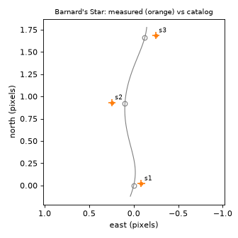
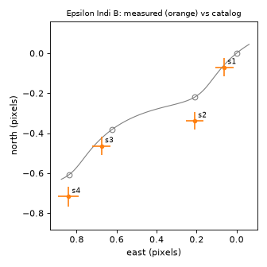
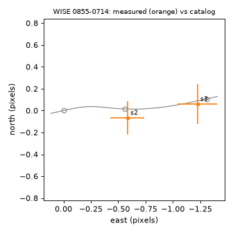

# Measured trajectory of the targets (task A5)

Generated by `python -m serafim.validation.trajectory` from the silver sums of D5.
In each sum of one detector and one season the target is fitted with a free position
(Gaussian PSF of the EPSF width, Gaia neighbours fitted too, pixels where a frame
saturated left out). The detectors of a season are combined; the catalog position of
that season includes the parallax seen from Earth. 1 pixel = 6.15 arcsec.

## Barnard's Star (`barnard`)

| Season | Detectors used | Measured − catalog (arcsec) | Error (arcsec) |
| --- | --- | --- | --- |
| 1 | 1, 2, 3, 4, 5, 6 | 0.54 | 0.26 |
| 2 | 1, 2, 3, 4, 5, 6 | 0.91 | 0.26 |
| 3 | 1, 2, 3, 4, 5, 6 | 0.78 | 0.26 |

**Motion:** measured 10.43 ± 0.37 arcsec/yr against 10.40 from the catalog over the same seasons (1, 2, 3).

## Epsilon Indi B (`eps_indi_b`)

| Season | Detectors used | Measured − catalog (arcsec) | Error (arcsec) |
| --- | --- | --- | --- |
| 1 | 2, 3, 4, 5, 6 | 0.58 | 0.28 |
| 2 | 2, 3, 4, 5, 6 | 0.74 | 0.28 |
| 3 | 1, 2, 3, 4, 6 | 0.60 | 0.28 |
| 4 | 2, 3, 5, 6 | 0.68 | 0.31 |

**Motion:** measured 4.56 ± 0.28 arcsec/yr against 4.62 from the catalog over the same seasons (1, 2, 3, 4).

## WISE 0855-0714 (`wise_0855`)

| Season | Detectors used | Measured − catalog (arcsec) | Error (arcsec) |
| --- | --- | --- | --- |
| 1 | none (not detected) | — | — |
| 2 | 6 | 0.52 | 0.95 |
| 3 | 6 | 0.59 | 1.12 |

**Motion:** measured 8.66 ± 3.18 arcsec/yr against 10.01 from the catalog over the same seasons (2, 3).

