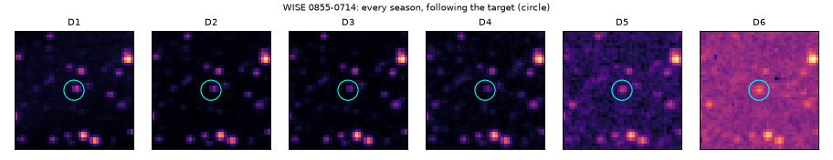
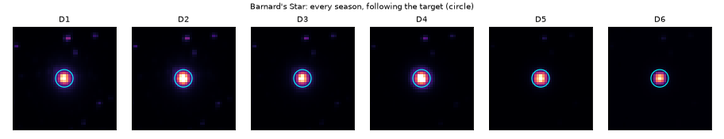

# Can SPHEREx see the targets? (visibility check, before task A6)

Generated by `python -m serafim.validation.visibility` from the bronze cutouts of
`python -m serafim bronze` (real IRSA frames, at most 12 per season and detector).

- **Brightness:** forced photometry at the target's position on each frame's date,
  stacked with inverse-variance weights (a Gaussian matched filter of the EPSF width).
  The noise is empirical: the same filter on the empty sky around the target.
  Verdict: seen if S/N >= 5, doubtful if >= 3, not seen below.
- **Motion:** a 2D Gaussian fitted to the pixels that are not saturated (nor BLOOM),
  on a grid fixed on the sky, per detector and season.

## WISE 0855-0714 (`wise_0855`)

Catalog: W1 = 16.231, W2 = 13.704 (Vega). 120 bronze frames.

**Neighbour stars fitted together with the target** (Gaia DR3, within 20″ of
the target in some season; their light is not the target's):

- Gaia DR3 5756956644387831296, G = 16.31

| Detector | Frames | Flux (mJy) | S/N, all seasons | Verdict | S/N per season | S/N without the neighbour model |
| --- | --- | --- | --- | --- | --- | --- |
| 1 | 24 | -0.089 ± 0.031 | -2.9 | not seen | s1: 0.0, s2: -2.6, s3: -1.3 | 13.2 |
| 2 | 24 | -0.086 ± 0.034 | -2.5 | not seen | s1: -1.5, s2: -0.5, s3: -2.3 | 9.6 |
| 3 | 25 | -0.024 ± 0.032 | -0.8 | not seen | s1: -0.2, s2: -0.7, s3: -0.4 | 8.7 |
| 4 | 12 | -0.008 ± 0.035 | -0.2 | not seen | s1: -0.3, s2: -0.3, s3: 0.2 | 4.6 |
| 5 | 15 | 0.281 ± 0.045 | 6.3 | seen | s1: 3.5, s2: 3.8, s3: 3.6 | 9.1 |
| 6 | 20 | 0.606 ± 0.063 | 9.6 | seen | s2: 7.7, s3: 5.7 | 11.9 |

Control stars (CatWISE, W2 close to the target's, same frames):

| Star | W2 | Detector | S/N, all seasons |
| --- | --- | --- | --- |
| CWISE J085509.47-071502.9 | 13.75 | 5 | 10.4 |
| CWISE J085509.47-071502.9 | 13.75 | 6 | 11.1 |
| CWISE J085454.83-071311.0 | 14.14 | 5 | 25.7 |
| CWISE J085454.83-071311.0 | 14.14 | 6 | 17.5 |
| CWISE J085502.36-071214.7 | 13.25 | 5 | 31.8 |
| CWISE J085502.36-071214.7 | 13.25 | 6 | 18.0 |
| CWISE J085511.23-071522.6 | 13.88 | 5 | 64.8 |
| CWISE J085511.23-071522.6 | 13.88 | 6 | 47.2 |

| Detector | Seasons | Measured shift (px) | Expected (px) | Largest offset from the catalog position (px) |
| --- | --- | --- | --- | --- |
| 6 | 2->3 | 0.86 | 0.57 | 0.27 |

In the detectors where the target is not seen, the dot inside the circle is the
neighbour star listed above, smeared because the stack follows the target.

## Barnard's Star (`barnard`)

Catalog: W1 = 4.358, W2 = 3.658 (Vega). 165 bronze frames.

**Neighbour stars fitted together with the target** (Gaia DR3, within 20″ of
the target in some season; their light is not the target's):

- Gaia DR3 4472835979222166400, G = 17.45
- Gaia DR3 4472835876142910336, G = 16.70
- Gaia DR3 4472835979222176256, G = 18.79

**Brightness is not measured here:** the center is saturated in every detector,
so a point-source flux would be meaningless. It is obviously seen. Its brightness
comes from task A4 (the unsaturated wings, with the EPSF).

| Detector | Seasons | Measured shift (px) | Expected (px) | Largest offset from the catalog position (px) |
| --- | --- | --- | --- | --- |
| 1 | 1->3 | 2.12 | 1.62 | 0.74 |
| 2 | 1->3 | 2.00 | 1.68 | 0.53 |
| 3 | 1->2 | 0.73 | 1.02 | 0.35 |
| 4 | 1->3 | 1.43 | 1.64 | 1.35 |
| 5 | 1->3 | 1.59 | 1.67 | 0.20 |
| 6 | 1->3 | 1.60 | 1.67 | 0.25 |

